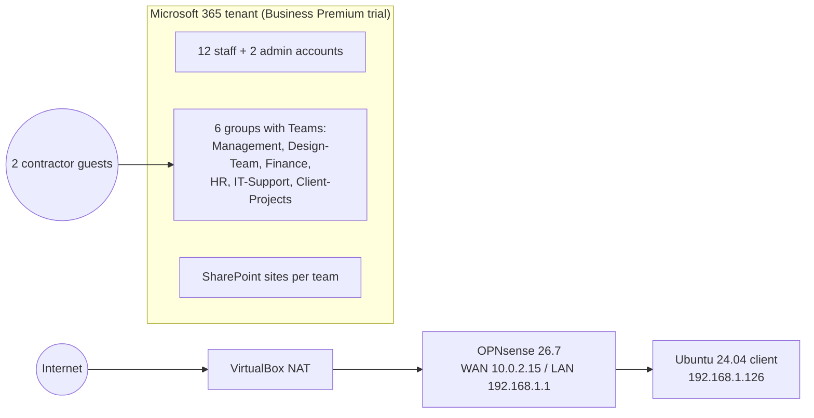

# PixelNest Microsoft 365 and Network Security Assessment

A 7-day hands-on security assessment of a small business environment: a Microsoft 365 Business Premium tenant (Entra ID, Teams, SharePoint) and an OPNsense firewall protecting an office network. I built the environment, planted realistic misconfigurations, then assessed and fixed it as an outside reviewer would: discover, assess, prioritize, remediate, document, hand off.

Author: Blandine Ngwing-Allah

> PixelNest Creative Studio is fictional. The tenant is a trial with fictional users. No production systems or real customer data were used.

## Results at a glance

| | |
|---|---|
| Findings | 19 (3 Critical, 4 High, 8 Medium, 4 Low) |
| Fixed | 19 of 19 |
| Planted issues found | 9 of 9 |
| Findings found beyond the planted set | 10 |
| Evidence screenshots | 56, named by day and step |
| Secure Score baseline | 83.11% (similar organizations: 46.28%) |
| MFA registered | 3 of 17 accounts |

| ID | Top findings | Rating |
|----|--------------|--------|
| F-01 | Firewall WAN rule allows any to any | Critical (25) |
| F-02 | RDP (TCP 3389) open from the internet to a staff PC | Critical (20) |
| F-03 | Designer's everyday account holds Global Administrator | Critical (20) |
| F-04 | FTP (TCP 21) open from the internet | High (12) |
| F-05 | Designer has access to Finance and HR data | High (12) |
| F-06 | Invoice spreadsheet shared with a public edit link | High (12) |
| F-07 | 14 of 17 accounts have no MFA registered | High (12) |

Full list: [findings/risk-register.md](findings/risk-register.md)

## Environment



Details: [docs/architecture.md](docs/architecture.md)

## What I did

| Day | Focus | Output |
|-----|-------|--------|
| 1 | Built the tenant, 14 accounts, 6 groups, 2 guests, OPNsense and Ubuntu VMs; tightened the LAN policy; planted 7 issues | Architecture doc and diagram |
| 2 | Reviewed admin roles, users, sign-ins, group membership and ownership, guests, security defaults, MFA, Secure Score | 7 identity findings |
| 3 | Reviewed Teams meeting, messaging, channel, guest and external access settings and team privacy | 4 Teams findings |
| 4 | Created test data, planted 2 sharing issues, reviewed org, site and file sharing | 3 SharePoint findings |
| 5 | Backed up the firewall config, documented every rule, scanned the firewall with nmap, wrote the remediation plan | 5 firewall findings, plan |
| 6 | Rated every finding and fixed all 19, Critical first | Remediation plan |
| 7 | Wrote the report, risk register and handoff guide | This repository |

## Repository

```
PixelNest-Security-Assessment/
├── README.md
├── report/
│   ├── PixelNest-Security-Assessment.md   full report
│   └── Admin-Handoff-Guide.md             runbook for the next admin
├── findings/
│   ├── risk-register.xlsx                 scored register with summary chart
│   └── risk-register.md                   same, readable on GitHub
├── remediation/
│   ├── remediation-plan.md                every fix with a verification step
│   ├── firewall-plan.md                   firewall changes with rollback
│   └── change-log.xlsx                    change record template
├── evidence/
│   ├── README.md                          index of every screenshot
│   └── day1/ ... day5/                    redacted screenshots
├── configs/
│   ├── firewall-rules-export.csv          OPNsense rule export
│   └── opnsense-config-excerpt-sanitized.xml
└── docs/
    ├── architecture.md
    ├── pixelnest-architecture.png
    └── lab-conditions.md                  answer key for planted issues
```

## How to read it
1. Start with the [report](report/PixelNest-Security-Assessment.md) executive summary.
2. Check any finding against its screenshot in the [evidence index](evidence/README.md).
3. See how each fix is applied and verified in the [remediation plan](remediation/remediation-plan.md).
4. Compare results with the [answer key](docs/lab-conditions.md) for the planted issues.

## Skills shown
- Microsoft Entra ID: role review, least privilege, guest lifecycle, MFA and security defaults
- Microsoft Teams and SharePoint: meeting, external access and sharing controls at org, site and file level
- Network security: OPNsense rule design, aliases, default deny, exposure scanning with nmap
- Risk management: likelihood x impact scoring, remediation with rollback, change control
- Documentation: architecture, evidence handling, executive reporting, admin runbooks

## Evidence note
Screenshots show the environment before remediation. Fixes were applied on Day 6 without after screenshots.

## Redaction
Guest email addresses and public IP addresses are blacked out in screenshots. The firewall config is published as an excerpt with the root password hash and TLS private key removed. Tenant user names are fictional.

## Tools
Microsoft 365 admin centers (Entra, Teams, SharePoint, Defender), OPNsense 26.7, VirtualBox, Ubuntu 24.04, nmap 7.94, draw.io, Excel.
