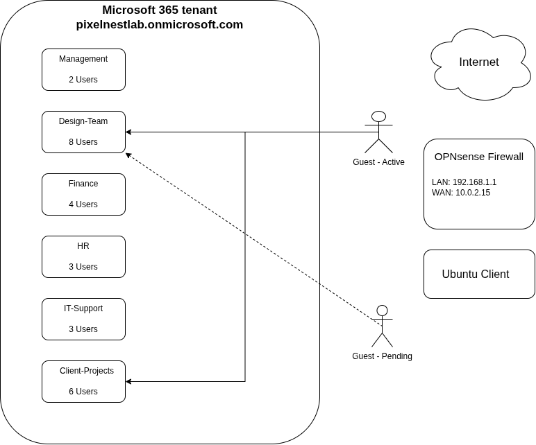
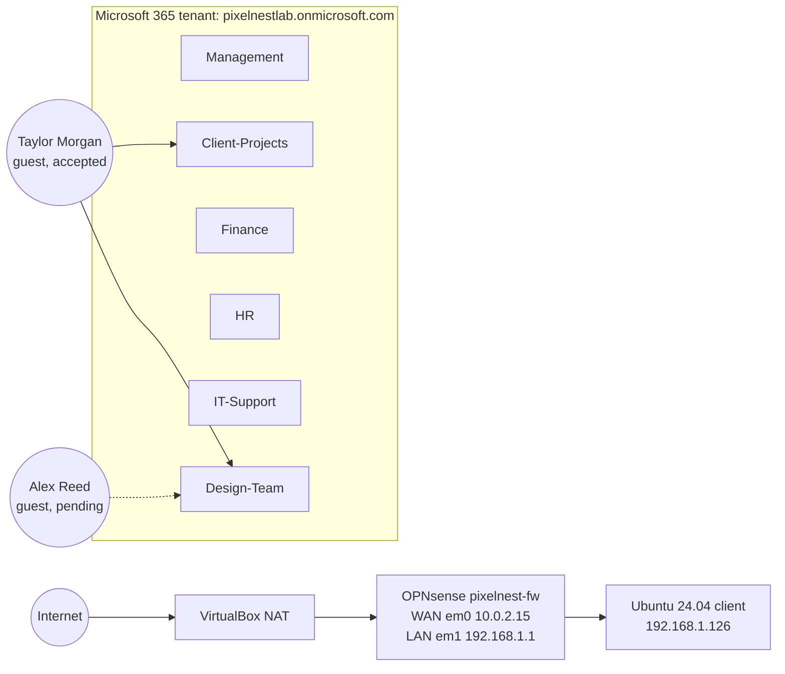

# PixelNest Creative Studio: Environment Architecture

Recorded as built on Day 1, including the planted issues. Issues are labeled in the findings, not here.

## 1. Tenant

| Item | Value |
|------|-------|
| Tenant | pixelnestlab.onmicrosoft.com |
| License | Microsoft 365 Business Premium (trial) |
| Licenses used | 13 of 25 (12 staff plus the break-glass admin) |
| Trial | Started 28/09/2026, 1 month, recurring billing Off |
| Security defaults | Enabled |

## 2. Users

| Name | UPN | Department | Job title | License | Admin role |
|------|-----|------------|-----------|---------|-----------|
| Blandine Forntoh | admin@ (break-glass) | | | Business Premium | Global Administrator |
| Olivia Grant | olivia.grant@ | Management | CEO | Business Premium | None |
| Marcus Lee | marcus.lee@ | Management | Operations Manager | Business Premium | None |
| Priya Shah | priya.shah@ | Design | Creative Director | Business Premium | None |
| Sofia Alvarez | sofia.alvarez@ | Design | Designer | Business Premium | None |
| Mia Chen | mia.chen@ | Design | Designer | Business Premium | None |
| Daniel Kim | daniel.kim@ | Design | Designer | Business Premium | Global Administrator |
| Ethan Brooks | ethan.brooks@ | Design | Designer | Business Premium | None |
| Rachel Adams | rachel.adams@ | Finance | Finance Lead | Business Premium | None |
| Noah Patel | noah.patel@ | Finance | Bookkeeper | Business Premium | None |
| Hannah Price | hannah.price@ | HR | HR Manager | Business Premium | None |
| Jordan Blake | jordan.blake@ | IT Support | IT Lead | Business Premium | None |
| Sam Rivera | sam.rivera@ | IT Support | IT Support | Business Premium | None |
| Jordan Blake (Admin) | adm-jordan.blake@ | | | Unlicensed | User Administrator |

All UPNs end in @pixelnestlab.onmicrosoft.com.

## 3. Groups (Microsoft 365, all Private, all with a Team)

| Group | Owners | Members |
|-------|--------|---------|
| Design-Team | Priya Shah, Olivia Grant | Priya Shah, Sofia Alvarez, Mia Chen, Daniel Kim, Ethan Brooks, Taylor Morgan (guest), Alex Reed (guest) |
| Finance | Rachel Adams, Olivia Grant | Rachel Adams, Noah Patel, Sofia Alvarez |
| HR | Hannah Price, Olivia Grant | Hannah Price, Sofia Alvarez |
| Management | Marcus Lee, Olivia Grant | Marcus Lee, Olivia Grant |
| IT-Support | Jordan Blake, Olivia Grant | Jordan Blake, Sam Rivera |
| Client-Projects | Priya Shah, Marcus Lee | Priya Shah, Marcus Lee, Daniel Kim, Ethan Brooks, Taylor Morgan (guest) |

The tenant also has the default org-wide team Pixelnestlab (Public, 14 members) and the All Company community.

## 4. Guests

| Name | Company | Invite status | Groups |
|------|---------|---------------|--------|
| Taylor Morgan | Morgan Illustration | Accepted | Client-Projects, Design-Team |
| Alex Reed | Reed Studio | Pending acceptance | Design-Team |

## 5. Network

| Item | Value |
|------|-------|
| Firewall | OPNsense 26.7 (amd64) on FreeBSD 15.1, hostname pixelnest-fw.pixelnest.lab |
| WAN | em0, DHCP, 10.0.2.15/24 behind VirtualBox NAT |
| LAN | em1, 192.168.1.1/24, DHCP range 192.168.1.41 to .245 |
| Client | Ubuntu 24.04 Desktop, 192.168.1.126 |
| Web GUI | HTTPS, self-signed certificate |

### Firewall rules (as found)

| Seq | Interface | Action | Protocol | Source | Destination | Port | Enabled | Description |
|-----|-----------|--------|----------|--------|-------------|------|---------|-------------|
| 1 | LAN | Pass | any (IPv4) | LAN net | any | any | No | Default allow LAN to any rule |
| 11 | LAN | Pass | any (IPv6) | LAN net | any | any | No | Default allow LAN IPv6 to any rule |
| 111 | WAN | Pass | TCP | any | 192.168.1.126 | 3389 (RDP) | Yes | Temp remote access |
| 211 | WAN | Pass | TCP | any | 192.168.1.126 | 21 (FTP) | Yes | Old client file transfer |
| 311 | WAN | Pass | any | any | any | any | Yes | Testing |
| 411 | LAN | Pass | TCP/UDP | LAN net | This Firewall | 53 (DNS) | Yes | Allow DNS to firewall |
| 511 | LAN | Pass | TCP | LAN net | any | web_ports (80, 443) | Yes | Allow web browsing |

Logging is off on every rule. Source: [configs/firewall-rules-export.csv](../configs/firewall-rules-export.csv).

## 6. Diagram

Group counts in the diagram show everyone with access to the group (members plus owners).

