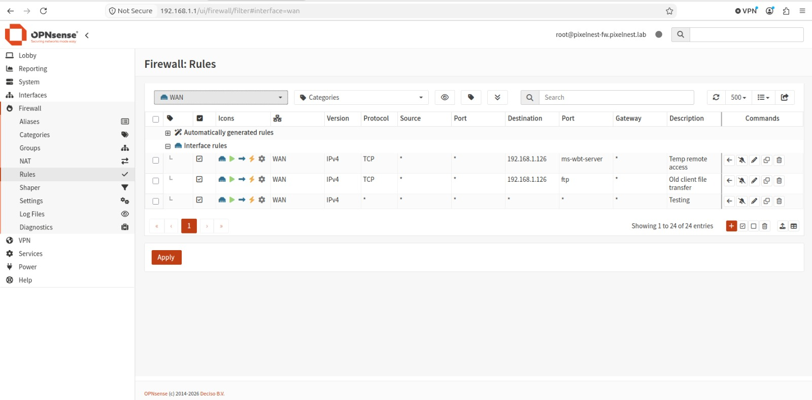
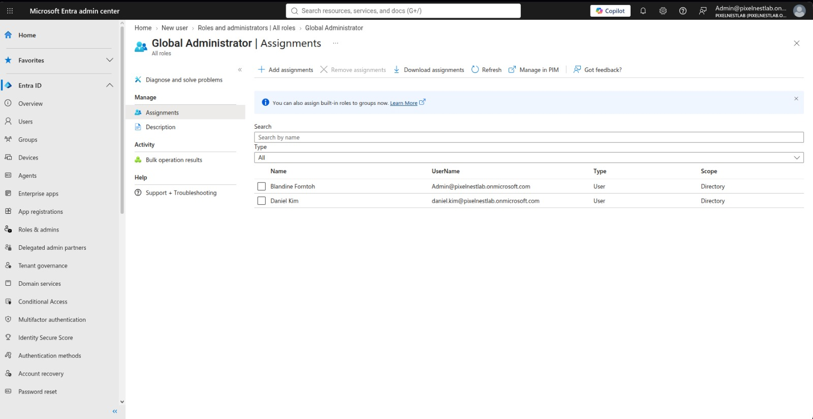
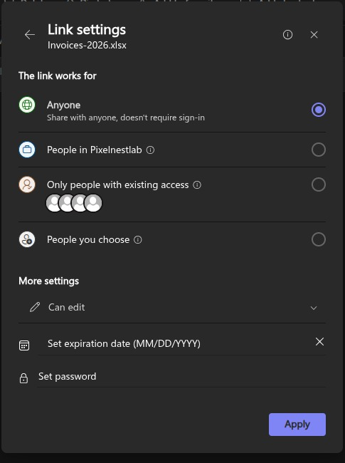
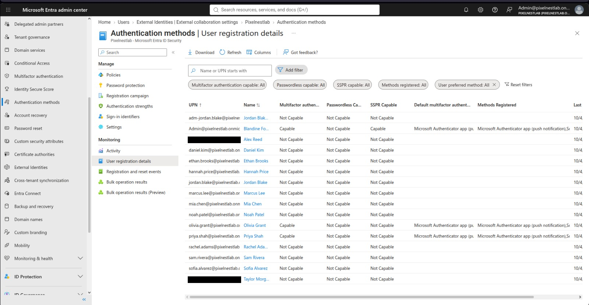

# PixelNest Creative Studio: Microsoft 365 and Network Security Assessment

Author: Blandine Ngwing-Allah  
Assessment period: 28 September to 28 October 2026  
Version: 1.0

> PixelNest Creative Studio is a fictional organization built for education and portfolio use. The tenant is a Microsoft 365 trial with fictional users. No production systems, real customer data or confidential information were used.

## 1. Executive summary

PixelNest asked for a review of its Microsoft 365 tenant and office firewall. I reviewed admin roles, users, groups, guests, MFA, Teams, SharePoint sharing and firewall rules.

I found 19 issues: 3 Critical, 4 High, 8 Medium and 4 Low.

The three Critical issues put the whole business at risk:
1. The firewall lets any traffic from the internet into the office network.
2. Remote Desktop (RDP) on a staff computer is open to the internet.
3. A designer's everyday account holds Global Administrator, the role that controls the entire tenant.

The High issues expose finance and HR data: a designer can read salary and invoice files, an invoice spreadsheet has a public edit link, and 14 of 17 accounts have no MFA registered.

The tenant also has good foundations. Security defaults are on, Secure Score is 83.11% against 46.28% for similar organizations, all department teams are private with 2 owners, and the office network allows only DNS and web traffic out.

I fixed all 19 findings on Day 6, Critical first. The firewall no longer accepts inbound traffic from the internet, Daniel Kim no longer holds Global Administrator, Sofia Alvarez no longer reaches Finance and HR data, and the public invoice link is gone. Each fix and its check is listed in [remediation/remediation-plan.md](../remediation/remediation-plan.md).

Top 3 recommendations:
1. Provide remote access through a VPN so the RDP rule is not re-opened.
2. Require MFA for every account through Conditional Access.
3. Review guests, group membership and sharing links every quarter.

## 2. Scope and method

In scope:
- Microsoft Entra ID: roles, users, groups, guests, external collaboration, security defaults, MFA registration
- Microsoft Teams: meeting, messaging, channel, guest and external access settings, team membership
- SharePoint and OneDrive: org, site and file sharing
- OPNsense firewall: rules, exposed services, version

Process: Discover, Assess, Prioritize, Remediate, Document, Handoff.

| Day | Work |
|-----|------|
| 1 | Build tenant, users, groups, guests, firewall lab; plant test issues; document architecture |
| 2 | Identity review: roles, users, groups, guests, MFA baseline |
| 3 | Teams configuration, guest and external access, team membership |
| 4 | SharePoint and OneDrive sharing, file permissions |
| 5 | Firewall rules, exposed services, remediation plan |
| 6 | Risk rating and remediation |
| 7 | Report, handoff guide, presentation |

Tools: Microsoft 365, Entra, Teams, SharePoint and Defender admin centers; OPNsense 26.7; VirtualBox; Ubuntu 24.04; nmap 7.94; draw.io; Excel.

Each finding is scored Likelihood (1-5) x Impact (1-5): 20-25 Critical, 12-19 High, 6-11 Medium, 1-5 Low.

### Lab limits
- Trial tenant with 12 fictional staff and 2 guests. Some issues were planted to test the review.
- The WAN could not be scanned from outside because of VirtualBox NAT. WAN exposure was assessed from the rule table.
- Audit and sign-in data cover a short period because the tenant is new.
- No penetration testing or exploitation was performed.
- Fixes were applied on Day 6 without after screenshots. Evidence in this repository shows the state before each fix.

## 3. Environment

A 12-person remote design studio. 6 Microsoft 365 groups with Teams (Management, Design-Team, Finance, HR, IT-Support, Client-Projects), 2 contractor guests, and a small office network with an OPNsense firewall between the internet and one Ubuntu workstation. Full detail: [docs/architecture.md](../docs/architecture.md).


## 4. Findings summary

| ID | Finding | Score | Rating | Status |
|----|---------|-------|--------|--------|
| F-01 | WAN rule allows any to any | 25 | Critical | Remediated |
| F-02 | RDP (TCP 3389) open from the WAN | 20 | Critical | Remediated |
| F-03 | Designer holds Global Administrator | 20 | Critical | Remediated |
| F-04 | FTP (TCP 21) open from the WAN | 12 | High | Remediated |
| F-05 | Designer is a member of Finance and HR | 12 | High | Remediated |
| F-06 | Anyone edit link on invoice file; org allows Anyone links | 12 | High | Remediated |
| F-07 | 14 of 17 accounts not registered for MFA | 12 | High | Remediated |
| F-08 | Stale guest with Design-Team access | 9 | Medium | Remediated |
| F-09 | Contractor in internal Design-Team | 9 | Medium | Remediated |
| F-10 | Anyone can invite guests; group owners can add guests | 9 | Medium | Remediated |
| F-11 | Teams external access open to all domains and personal accounts | 9 | Medium | Remediated |
| F-12 | Sensitive sites allow external sharing | 9 | Medium | Remediated |
| F-13 | Anonymous users can join meetings unverified | 6 | Medium | Remediated |
| F-14 | Direct edit share to a guest on a client folder | 6 | Medium | Remediated |
| F-15 | Break-glass admin is licensed with a mailbox | 6 | Medium | Remediated |
| F-16 | Firewall rule hygiene | 4 | Low | Remediated |
| F-17 | Org-wide team is Public | 4 | Low | Remediated |
| F-18 | Any user can create private and shared channels | 4 | Low | Remediated |
| F-19 | Firewall update pending | 4 | Low | Remediated |

Every finding with its description, evidence and recommendation: [findings/risk-register.md](../findings/risk-register.md).

## 5. Key findings in detail

### F-01 WAN rule allows any to any (Critical, 25)
The WAN rule named Testing passes all IPv4 traffic from any source to any destination. OPNsense blocks unmatched inbound traffic by default, but this pass rule sits above that block and cancels it. In a real office, every service on every LAN device would face the internet.



Fix: rule deleted. The default deny now handles unmatched inbound traffic.

### F-02 RDP open from the WAN (Critical, 20)
Temp remote access passes TCP 3389 to 192.168.1.126. RDP is among the most scanned ports on the internet and a common starting point for password spraying and ransomware.

Fix: rule deleted. Next step: give remote staff a WireGuard VPN with MFA-protected accounts, so the rule does not come back.

### F-03 Designer holds Global Administrator (Critical, 20)
Daniel Kim, a Designer, holds Global Administrator on the same licensed account he uses for email and Teams. If that password is phished, the attacker can change any setting, read any mailbox and lock out the real admins.



Fix: created a second unlicensed break-glass account, then removed the role from Daniel Kim. Jordan Blake's separate, unlicensed adm-jordan.blake account with User Administrator shows the right pattern already exists in the tenant.

### F-05 Designer in Finance and HR (High, 12)
Sofia Alvarez belongs to Finance and HR on top of Design-Team. Those groups hold invoices, salary bands and personal records.

Fix: removed both memberships. Membership is now reviewed against department every quarter.

### F-06 Public edit link on the invoice file (High, 12)
Invoices-2026.xlsx has an Anyone link with edit rights. Anyone who gets the link can read and change the file without signing in. Org sharing for SharePoint and OneDrive is at the most open level, the default permission is Edit, and Anyone links never expire.



Fix: deleted the link; set org sharing to New and existing guests, default link Specific people, default permission View.

### F-07 MFA not registered (High, 12)
Only 3 of 17 accounts are MFA capable (admin, Olivia Grant, Priya Shah). Security defaults ask the others to register at first sign-in, which means whoever signs in first with a stolen password registers their own device.



Fix: ran a registration campaign. Next step: require MFA for all users through Conditional Access.

## 6. What is working well

| Area | Result | Evidence |
|------|--------|----------|
| Security defaults | Enabled; legacy authentication blocked | [D2-15](../evidence/day2/D2-15-security-defaults.png) |
| Secure Score | 83.11% (53.19 of 64), similar organizations 46.28 | [D2-17](../evidence/day2/D2-17-secure-score.png) |
| Admin separation | adm-jordan.blake is unlicensed and holds only User Administrator | [D2-03](../evidence/day2/D2-03-user-admins.png) |
| Other admin roles | Privileged Role, Exchange, SharePoint and Teams Administrator are empty | [D2-02](../evidence/day2/D2-02-privileged-role-admins.png) |
| Teams | All 6 department teams are Private with 2 owners | [D3-08](../evidence/day3/D3-08-teams-list.png) |
| Meeting lobby | Only org members and guests bypass; dial-in callers wait | [D3-01](../evidence/day3/D3-01-meeting-policy.png) |
| Guest directory access | Guests have limited access to directory objects | [D2-14](../evidence/day2/D2-14-external-collab.png) |
| LAN policy | Default allow-all rules disabled; only DNS to the firewall and web (80, 443) allowed out | [D1-06b](../evidence/day1/D1-06b-lan-rules.png) |
| Exposed services | Only 53, 80 and 443 answer on the firewall; 997 ports filtered; port 80 redirects to HTTPS | [D5-05](../evidence/day5/D5-05-nmap.png) |

## 7. Remaining risks

All 19 findings were fixed. Risks that remain:
- Guest access in Teams stays on because contractors need Client-Projects. Control rests on group membership and a quarterly review.
- Security defaults still enforce MFA. Conditional Access gives finer control and is the next step.
- Remote access needs a VPN so nobody re-opens RDP to meet the need.
- Client work for different clients sits in one Client-Projects library.

## 8. 30/60/90 day plan

| When | Action | Owner |
|------|--------|-------|
| 30 days | Conditional Access policy requiring MFA for admins, then all users | IT Lead |
| 30 days | Guest approval process documented; guest invites limited to admins | Operations Manager |
| 60 days | One private channel or team per client | Creative Director |
| 60 days | WireGuard VPN for remote access | IT Lead |
| 90 days | First quarterly review of groups, guests, sharing links and firewall rules | IT Lead |
| 90 days | Sensitivity labels on Finance and HR files | IT Lead with HR |

## Appendix A: Teams settings

| Setting | Current value | Suggested | Finding |
|---------|---------------|-----------|---------|
| Anonymous users can join a meeting unverified | On | On, verified, wait in lobby | F-13 |
| Anonymous users can interact with apps in meetings | On | Off | F-13 |
| Who can bypass the lobby | People in my org and guests | No change | No |
| People dialing in can bypass the lobby | Off | No change | No |
| Delete sent messages | On | Observation; rely on retention policies | No |
| Create private channels | On | Owners only, or accept | F-18 |
| Create shared channels / invite external users | On / On | Restrict | F-18 |
| Group owners can add guests | On | Off or approval step | F-10 |
| Guest access in Teams | On | On, limited to Client-Projects | Accepted |
| Guest screen sharing | Entire screen | No change | No |
| External access domains | Allow all | Client domains only | F-11 |
| Chat with unmanaged Microsoft accounts | On | Off | F-11 |

## Appendix B: Firewall rules

See [docs/architecture.md section 5](../docs/architecture.md#5-network) and [configs/firewall-rules-export.csv](../configs/firewall-rules-export.csv).

| Rule | Needed | Rating |
|------|--------|--------|
| WAN pass any to any (Testing) | No | Critical (F-01) |
| WAN pass any to 192.168.1.126 TCP 3389 | No | Critical (F-02) |
| WAN pass any to 192.168.1.126 TCP 21 | No | High (F-04) |
| LAN pass LAN net to This Firewall 53 | Yes | Acceptable |
| LAN pass LAN net to any 80, 443 | Yes | Acceptable |
| LAN default allow IPv4 and IPv6 (disabled) | No | Low (F-16) |

## Appendix C: nmap scan of the firewall (LAN side)

```
# Nmap 7.94SVN scan initiated Wed Oct 28 10:50:31 2026 as: nmap -sS -sV -oN nmap-firewall.txt 192.168.1.1
Nmap scan report for pixelnest-fw.pixelnest.lab (192.168.1.1)
Host is up (0.00091s latency).
Not shown: 997 filtered tcp ports (no-response)
PORT    STATE SERVICE  VERSION
53/tcp  open  domain   Unbound 1.25.1
80/tcp  open  http     OPNsense
443/tcp open  ssl/https OPNsense
```
